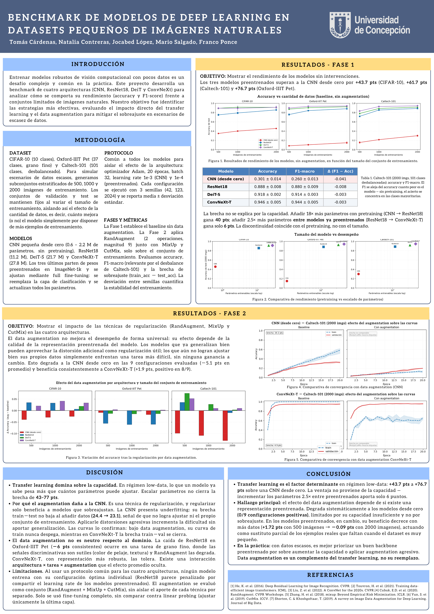
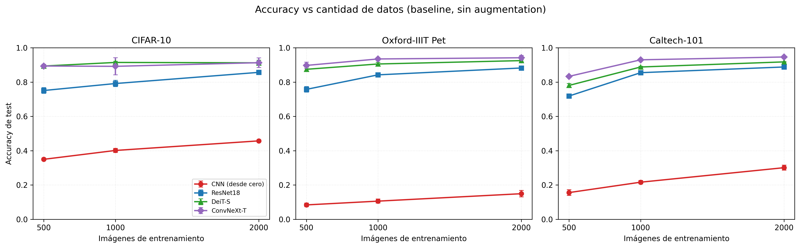
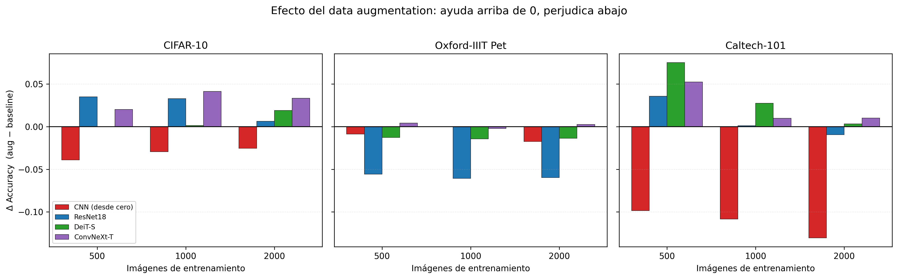

# Benchmark de modelos de deep learning con pocos datos

Proyecto del curso **Deep Learning** (Universidad de Concepción, 2026). Trabajo en grupo: Tomás Cárdenas, Natalia Contreras, Jocabed López, Mario Salgado Orellana y Franco Ponce.

> **Mi aporte:** diseñé el protocolo experimental común (splits reproducibles, motor de entrenamiento, métricas y registro de resultados) y escribí el código base de los cuatro notebooks de modelos. Coordiné la ejecución de los experimentos (cada integrante corrió y ajustó el notebook de su modelo; yo me encargué de ConvNeXt-Tiny) e hice el análisis conjunto (`05_analisis_conjunto.ipynb`), que integra los resultados de los cuatro modelos y genera las figuras y tablas del póster.

**¿Qué modelo y qué estrategia conviene usar cuando hay pocas imágenes etiquetadas?** Comparamos cuatro arquitecturas: una **CNN entrenada desde cero**, **ResNet18**, **DeiT-Small** (Vision Transformer) y **ConvNeXt-Tiny**. Las probamos en tres datasets de imágenes naturales (CIFAR-10, Oxford-IIIT Pet y Caltech-101) con solo **500, 1.000 y 2.000 imágenes de entrenamiento**, y medimos el efecto del **transfer learning** y del **data augmentation** (RandAugment + MixUp + CutMix) sobre accuracy, F1-macro, estabilidad y sobreajuste.

En total son 4 modelos × 3 datasets × 3 tamaños × 3 semillas × 2 fases = **216 entrenamientos**.

<details>
<summary><b>🇬🇧 English summary</b></summary>

<br>

**Benchmarking deep learning models on small image datasets.** Course project for *Deep Learning* at the University of Concepción (Chile), 2026. Team project.

**Question:** which model and which strategy work best when only a few labeled images are available? We compared four architectures: a **CNN trained from scratch**, **ResNet18**, **DeiT-Small** (Vision Transformer) and **ConvNeXt-Tiny**. We tested them on three natural-image datasets (CIFAR-10, Oxford-IIIT Pet and Caltech-101) with only **500, 1,000 and 2,000 training images**, and measured the effect of **transfer learning** and **data augmentation** (RandAugment + MixUp + CutMix). In total: 216 training runs, with 3 random seeds per configuration.

**Key findings**
- **Transfer learning is the dominant factor.** Pretrained models beat the CNN trained from scratch by +43.7 to +76.7 accuracy points.
- **The gain does not come from model size.** Going from the CNN to ResNet18 adds ~40 points, but going from ResNet18 to ConvNeXt-T (2.5× more parameters) adds only ~6.
- **Data augmentation is not universally helpful.** It hurt the CNN trained from scratch in all 9 configurations and improved ConvNeXt-T in 8 of 9. Its benefit for pretrained models shrinks as the dataset grows.
- **Best model:** ConvNeXt-T, with 94.6% test accuracy on Caltech-101 using only 2,000 training images.

**My contribution:** I designed the shared experimental protocol (reproducible splits, training engine, metrics and results logging) and wrote the base code for the four model notebooks. I coordinated the experiments (each teammate ran the notebook for their model; I handled ConvNeXt-Tiny) and built the joint analysis that produced the figures and tables for the poster.

**Stack:** Python, PyTorch, torchvision, timm, pandas, Matplotlib, Jupyter, Google Colab.

**Known issue:** a duplicated dictionary key made the CNN train with a learning rate of 1e-4 instead of the intended 1e-3. I later verified this by retraining one experiment with both values (see *Limitaciones*). The main conclusions still hold.

</details>



## Resultados principales

| Hallazgo | Evidencia |
|---|---|
| **El transfer learning es lo que más influye** | Los modelos preentrenados superan a la CNN desde cero por **+43.7 pts** (CIFAR-10), **+61.7 pts** (Caltech-101) y **+76.7 pts** (Oxford Pet). |
| **La ventaja no viene de tener más parámetros** | Pasar de la CNN a ResNet18 (18× más parámetros, con pretraining) suma ~40 pts. Pasar de ResNet18 a ConvNeXt-T (2.5× más, ambos preentrenados) suma solo ~6 pts. |
| **El data augmentation no siempre ayuda** | Empeora a la CNN desde cero en las 9 configuraciones (−5.1 pts en promedio) y mejora a ConvNeXt-T en 8 de 9 (+1.9 pts). |
| **El augmentation sirve más cuando hay menos datos** | En los modelos preentrenados aporta +1.72 pts con 500 imágenes y −0.09 pts con 2.000. |

Accuracy en test con 2.000 imágenes de entrenamiento y sin augmentation (media ± desviación estándar con 3 semillas):

| Modelo | Parámetros | CIFAR-10 | Oxford Pet | Caltech-101 |
|---|---|---|---|---|
| CNN desde cero | 0.6 – 2.2 M | 0.457 ± 0.007 | 0.149 ± 0.019 | 0.301 ± 0.014 |
| ResNet18 | 11.2 M | 0.856 ± 0.003 | 0.882 ± 0.010 | 0.888 ± 0.008 |
| DeiT-S | 21.7 M | 0.912 ± 0.015 | 0.925 ± 0.006 | 0.918 ± 0.002 |
| **ConvNeXt-T** | 27.8 M | **0.913 ± 0.028** | **0.942 ± 0.014** | **0.946 ± 0.005** |

La tabla con los tres tamaños está en [`figuras/tabla1_accuracy_baseline.csv`](figuras/tabla1_accuracy_baseline.csv).





## Metodología

- **Datasets:** [CIFAR-10](https://www.cs.toronto.edu/~kriz/cifar.html) (10 clases), [Oxford-IIIT Pet](https://www.robots.ox.ac.uk/~vgg/data/pets/) (37 razas de perros y gatos, clasificación de grano fino) y [Caltech-101](https://data.caltech.edu/records/20086) (101 clases desbalanceadas).
- **Splits:** subconjuntos estratificados de entrenamiento de 500 / 1.000 / 2.000 imágenes. Validación y test se mantienen fijos, así la única variable es la cantidad de datos.
- **Entrenamiento común:** Adam, 20 épocas, batch 32 y learning rate 1e-4. Los modelos preentrenados en ImageNet se ajustan con full fine-tuning.
- **Semillas:** 42, 123 y 2024. Se reporta media ± desviación estándar, y la desviación se usa como medida de estabilidad.
- **Fase 1 (baseline):** entrenamiento sin augmentation.
- **Fase 2:** RandAugment (2 operaciones, magnitud 9) + MixUp (α=0.2) / CutMix (α=1.0), aplicado solo sobre el conjunto de entrenamiento.
- **Métricas:** accuracy, F1-macro (importante por el desbalance de Caltech-101), brecha de sobreajuste (`train_acc − test_acc`) y desviación entre semillas.

## Limitaciones

- **Learning rate de la CNN.** Se acordó un learning rate más alto para la CNN (1e-3) por no estar preentrenada, pero por una clave duplicada en la configuración (`{"cnn": 1e-3, ..., "cnn": 1e-4}`) se ejecutó con 1e-4, igual que los modelos preentrenados. El póster indica 1e-3; el valor real es 1e-4. Lo verifiqué después reentrenando un experimento (CIFAR-10, 1.000 imágenes, semilla 42) con ambos valores:

  | | test_acc | train_acc final | Brecha |
  |---|---|---|---|
  | Resultado del benchmark | 0.409 | 0.493 | 8.4 pts |
  | Reentrenado con 1e-4 | 0.421 | 0.489 | 6.8 pts |
  | Reentrenado con 1e-3 | 0.459 | 0.846 | 38.8 pts |

  Las dos fases de la CNN usaron el mismo valor, así que la comparación baseline vs augmentation es consistente. Las conclusiones principales tampoco cambian: con 1e-3 la CNN sube unos 5 pts, y la ventaja del transfer learning (+43 pts o más) se mantiene. Lo que sí cambia es el diagnóstico: el *underfitting* que se atribuye a la CNN se debe en buena parte al learning rate bajo. Con 1e-3 la CNN sobreajusta (brecha de ~39 pts), así que la explicación de por qué el augmentation la perjudica debería volver a evaluarse.
- **Mismos hiperparámetros para todos los modelos.** Se usó un protocolo común para aislar el efecto de la arquitectura, así que ningún modelo se entrenó con su configuración óptima.
- **Augmentation evaluado en conjunto.** RandAugment, MixUp y CutMix se aplicaron juntos, sin medir el aporte de cada técnica por separado.
- **Solo full fine-tuning.** No se comparó con *linear probing* (ajustar solo la última capa).

## Estructura

```
├── notebooks/
│   ├── 01_cnn_desde_cero.ipynb      CNN pequeña entrenada desde cero
│   ├── 02_resnet18.ipynb            ResNet18 preentrenada (fine-tuning)
│   ├── 03_deit_small.ipynb          DeiT-Small, Vision Transformer (timm)
│   ├── 04_convnext_tiny.ipynb       ConvNeXt-Tiny preentrenada
│   └── 05_analisis_conjunto.ipynb   junta los 4 modelos y genera figuras y tablas
├── resultados/                      un CSV por modelo (una fila por experimento) + predicciones e historiales
├── figuras/                         figuras y tablas finales (PNG, PDF, LaTeX)
├── datos/                           datasets (no se suben; ver datos/README.md)
└── docs/                            póster del proyecto
```

Los cuatro notebooks de modelos tienen la misma estructura: configuración, splits reproducibles, motor de entrenamiento, Fase 1, análisis y Fase 2. Además detectan solos si se ejecutan en local o en Google Colab.

## Cómo correrlo

```bash
pip install -r requirements.txt
```

1. Descarga los tres datasets en `datos/` (ver [`datos/README.md`](datos/README.md)). Cada notebook tiene una celda que revisa la estructura antes de entrenar.
2. Corre los notebooks `01` a `04` desde la carpeta `notebooks/`. Las rutas son relativas (`../datos`, `../resultados`). Si un experimento ya está en el CSV, no se vuelve a entrenar.
3. Corre `05_analisis_conjunto.ipynb` para regenerar todas las figuras y tablas. Este notebook no entrena nada: solo lee los CSV de `resultados/`, que ya vienen incluidos, así que puedes correrlo directamente.

Python 3.11, PyTorch 2.5 y timm 1.0.

## Documentos

- [`docs/poster.png`](docs/poster.png): póster con la metodología, los resultados y la discusión.

## Referencias

He et al. (2016), *ResNet*, CVPR · Touvron et al. (2021), *DeiT*, ICML · Liu et al. (2022), *A ConvNet for the 2020s*, CVPR · Cubuk et al. (2020), *RandAugment*, CVPR-W · Zhang et al. (2018), *mixup*, ICLR · Yun et al. (2019), *CutMix*, ICCV.
